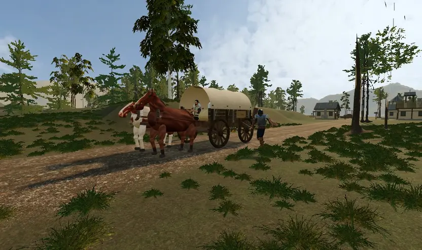

# Корованы · Дело о двух рогах — gpt-6.2-astra

Бурёнку записали в подорожную седьмой телегой и начислили ей налог за четыре колеса. Эльф, дворцовый стражник и горный владыка могут довести это дело до суда. Подлинник накладной хранится на мельнице, а конь при короване служит переводчиком. В «Почтовом перегоне» у Бурёнки другое дело — доставить во дворец шесть крынок молока.

[Играть на GitHub Pages](https://krestnikov.org/korovany/gpt-6.2-astra-goal/) · [Открыть локальный index.html](./index.html)

Это издание **Gpt-6.2-Astra + Goal**. Точное имя модели в метаданных запуска — **`gpt-6.2-astra`**.



## Первые минуты

- **Кампания.** Выберите одну из трёх сторон и нажмите **«Начать историю»**. Золотой ромб в мире и на компасе ведёт к первой цели. Подойдите и нажмите **E**. Если цель осталась позади, стрелка на краю компаса укажет направление. На карте **M** видны дороги, а в дневнике **J** остаются обещания и улики.
- **Почтовый перегон.** В главном меню нажмите **«Взять вожжи»**. Возница объяснит маршрут от Лесной почты до дворцовой кухни. Привезите хотя бы одну полную крынку. Во время кампании рейс можно взять у торговца и вернуться с заработком к своему герою.
- Звук начинается после действия в меню или входа в мир. В настройках отдельно регулируются музыка, русская речь и эффекты. Там же можно включить субтитры в пути, выбрать один из трёх режимов графики, чувствительность и покачивание камеры.

## Запуск и публикация

Откройте `index.html` из этой папки в браузере с WebGL. Для запуска через HTTP из родительского каталога выполните команду и перейдите на [локальную страницу игры](http://localhost:8000/gpt-6.2-astra-goal/).

```sh
python3 -m http.server 8000
```

Для GitHub Pages скопируйте папку издания целиком в публикуемый каталог. Точка входа — `gpt-6.2-astra-goal/index.html`. Все пути относительные. Three.js, изображения, музыка и голосовые записи входят в поставку. Игровому браузеру достаточно статических файлов.

## Управление

| Кампания | Клавиша или жест |
| --- | --- |
| Ходьба и обзор | WASD и мышь. Щелчок по миру захватывает указатель. ↑ и ↓ двигают героя, ← и → поворачивают камеру |
| Бег, прыжок, отскок назад | Shift, Пробел, C |
| Меч и лук | 1 и 2. Повторное нажатие 2 убирает лук |
| Удар или выстрел, пробивающий удар мечом | ЛКМ или F для обычной атаки, G для пробивающей |
| Щит и парирование | Удерживайте ПКМ или R с мечом. Поднимите щит во время замаха противника для контратаки |
| Разговор, торговля, сбор, двери, лестницы | E |
| Позвать Бурёнку | V или экранная кнопка «Му!». Издалека появятся направление и расстояние |
| Перевязка, приказ дружине владыки | H и Q |
| Дневник, карта, привал | J, M, Esc |
| Ручное сохранение | K |

| Почтовый перегон | Клавиша или жест |
| --- | --- |
| Разгон | W или ↑ |
| Тормоз и задний ход | S или ↓. Удерживайте после остановки, чтобы сдать назад |
| Руль | A и D или ← и → |
| Звонок у заставы | Пробел или экранная кнопка «Звонок» |
| Вид из-за повозки или с козел | V или экранная кнопка «Камера» |
| Пауза или возврат к последним воротам | Esc. Возврат прибавляет четыре секунды |

На сенсорном экране слева расположен джойстик. В кампании смахивание по миру поворачивает камеру, а кнопки справа отвечают за основные действия. В перегоне джойстик одновременно управляет тягой и поворотом.

## Кампания

**Лесной союз** защищает деревянное поселение, перехватывает груз и доставляет его лесному торговцу. Дозорная лестница выводит на настил над дорогой. **Дворцовая стража** принимает приказ капитана Арды, обороняет ворота от шпиона и партизана, совершает вылазку к форту и возвращается с докладом. **Тёмный владыка** сам выбирает цель набега, зовёт дружину за собой или оставляет бойцов держать позицию.

После первой вылазки три истории сходятся у мельницы Эльды. Осмотрите место перегрузки, поговорите со свидетелями и сравните накладную со следами у костра. У раненого писаря можно получить показания за бинт. Документы для ареста также хранятся внутри мельницы и в дворцовой Палате печатей. Решение у мельницы ведёт к одной из трёх задач — сопровождению возницы через две засады, перехвату регента Вельта или захвату казначейского ключа. У каждой стороны своё послесловие. После финала остаются торговля, мелкие поручения, почта и свободная дорога.

### Пограничье и корован

Четыре области соединены дорогами — Вольные земли, дворец императора, эльфийский лес и старый форт в Чёрных горах. Через реку проложены мосты и броды. На мелководье герой идёт медленнее. В угодьях Мары можно собрать травы и обменять их у травницы на три бинта. Вне ближнего боя карту можно использовать для быстрого перехода.

Тракт уходит за край карты и возвращается с противоположной стороны без загрузки. Полный прямой круг занимает 288 игровых метров. По дороге стоят четыре молочные заставы. Соберите печати с помощью **E**. Первые три приносят по 6 монет, четвёртая — 32. Паспорт остаётся в дневнике.

У корована есть два подхода. **E у телеги** вызывает на бой её охрану. После победы повторное **E** позволяет взять 42 монеты и бинт. **V у Бурёнки** открывает переговоры. Запомните три звуковых знака и ответьте в том же порядке. При успехе Бурёнка выдаёт тот же груз и заверяет накладную копытом. Эту подпись принимают в суде. Новый груз появляется через 95 игровых секунд. Во время сюжетного сопровождения с Бурёнкой можно договориться и о проходе через засаду.

### Бой и лечение

Стрелы летят по дуге и останавливаются у препятствий. Блок прикрывает спереди, а парирование открывает короткое окно для ответного удара. Для атак, бега и отскоков нужна выносливость. Сражаются и герой, и отряды противников и союзников. Побеждённый персонаж остаётся лежать в мире.

| Травма | Что меняется | Лечение и снаряжение |
| --- | --- | --- |
| Рука | Кровотечение, слабый удар другой рукой, потеря доступа к луку | Перевязка и протез руки |
| Глаз | Закрывается левая половина обзора | Глазной протез |
| Нога | Кровотечение, передвижение ползком, потеря прыжка | Перевязка, коляска или протез ноги |

Бинт останавливает кровь и восстанавливает до 34 единиц здоровья. У торговцев есть лечение, протезы, коляска, стрелы и три ступени улучшения оружия. На мельнице можно отдохнуть у очага.

## Почтовый перегон

По умолчанию камера следует за возницей и упряжкой. Клавиша **V** пересаживает камеру на козлы. Крынки качаются на багажной полке и исчезают по мере потери груза. Проезжайте через пять украшенных ворот по порядку. У двух шлагбаумов звоните с расстояния до 20 метров. На Соляном мосту сбросьте скорость до **18 км/ч**. После моста поверните направо у мельницы и направляйтесь к дворцовой кухне. Скорость, груз и время показаны на приборной панели.

Удар на обочине, закрытый шлагбаум или слишком быстрый проезд моста могут разбить крынку. Потеря всех шести завершает рейс. В рекорде сначала учитывается количество доставленного молока, при равном грузе — время. На рейсе из кампании торговец платит по 5 монет за целую крынку и ещё 10 за все шесть.

## Изображение и звук

У восьми персонажей разные лица. Для них, четырёх костюмов, Бурёнки и коня сделаны текстуры, подогнанные к объёмным моделям. Ветер шевелит лес и траву у дороги. На сбалансированной и высокой графике в воде у берега отражаются деревья и мост. Экономный режим использует отражение панорамы. Суставы ног и колёса упряжки анимируются в такт пройденному расстоянию. При приближении к ели появляются отдельные пучки хвои. [Материалы и художественные источники](./assets/ART.md)

В игру входят 82 заранее синтезированные русские записи для 15 ролей — около 12 минут речи. Файлы воспроизводятся даже при запуске с диска. У Бурёнки есть собственная система знаков и конь-переводчик. Говорят фракционные персонажи, жители, писарь, регент и возница. По ходу расследования можно слушать показания и прочитанные вслух находки. В составных эпилогах записи соответствуют выбранному исходу. Чтобы повторить реплику в сюжетном диалоге, нажмите кнопку с динамиком возле имени говорящего. Субтитры в пути показывают имя говорящего. [Голоса и подготовка записей](./assets/voice/CREDITS.md)

Для игры написаны четыре пьесы, вместе около четырёх минут музыки. В дороге звучит **«Соляной тракт»**, при появлении противника вступает марш **«Пятое копыто»**. Переговоры с Бурёнкой и почтовый рейс сопровождает **«Полька с подписью копытом»**, интерьер мельницы и дворцовый архив — **«Мельница хранит секреты»**. Между сценами музыка плавно меняется, при репликах становится тише. Возле реки слышна вода, по стуку копыт и колокольчику можно определить, с какой стороны подходит корован. [Слушать музыку и скачать четыре партитуры MIDI](./assets/music/CREDITS.md)

## Сохранения

У каждой фракции собственные слоты для ручной записи и сюжетной контрольной точки. **«Продолжить»** выбирает самую свежую. В запись входят ход расследования, улики, приказ дружине, положение повозки, посещаемый интерьер, ранения, инвентарь и состояние противников. После гибели можно вернуться к последней записи. Рекорд почтового рейса хранится отдельно. Самостоятельный заезд из меню оставляет кампанию доступной для продолжения.

Игра хранит данные в `localStorage` браузера по адресу сайта. При очистке данных адреса записи стираются. Для длинной кампании пользуйтесь одним адресом. При открытии с диска сохранения зависят от правил браузера для `file://`.

## Проверка и ограничения

Для запуска нужен браузер с WebGL. Это одиночное приключение с четырьмя областями, двумя доступными интерьерами и одним почтовым маршрутом. Проверки выполнялись в настольном Chrome. Сенсорные действия проверялись в мобильной эмуляции Chrome. Полного прогона на физических телефонах, в Firefox и Safari пока не было.

Браузерные сценарии используют Playwright. Для повторения запустите из каталога издания

```sh
npm install --no-save --package-lock=false playwright
npx playwright install chromium
node tests/campaign.cjs
node tests/regression.cjs
node tests/post-road.cjs
node tests/score.cjs
node tests/voices.cjs
```

| Сценарий | Что проверяет |
| --- | --- |
| [Кампания](./tests/campaign.cjs) | Три завязки, перемещение, бой, покупки, загрузку и девять сочетаний фракции с финалом. Перед развилкой используется сохранение, между действиями ускоряется симуляция |
| [Дорога и Бурёнка](./tests/regression.cjs) | Переход через край карты, столкновения, остановку упряжки перед героем, движение ног коня и коровы, мирный обмен, сохранение и приоритет взаимодействия |
| [Почтовый перегон](./tests/post-road.cjs) | Ворота и торможение, повреждения и потерю всего груза, идеальную доставку, личный рекорд, расчёт с героем и сенсорное управление |
| [Музыка](./tests/score.cjs) | Все четыре дорожки по HTTP в подкаталоге и с диска, уровень сигнала, переходы между темами, затихание под настоящую голосовую запись, восстановление громкости, выключение и повторный запуск |
| [Озвучка](./tests/voices.cjs) | Воспроизведение готовой речи, повтор и прерывание реплик, варианты эпилога, сохранение субтитров и уровней звука |

Для проверок можно выбрать установленный Chrome переменной `BROWSER_EXECUTABLE`. Переменная `GAME_URL` задаёт адрес проверяемой сборки. Звуковой сценарий по умолчанию сам поднимает временный HTTP-сервер и затем открывает локальный файл.

Происхождение иллюстраций, инструментов и голосов указано в титрах. [Художественные материалы](./assets/ART.md) · [Музыка](./assets/music/CREDITS.md) · [Озвучка](./assets/voice/CREDITS.md) · [Лицензия Three.js r159](./vendor/three-LICENSE.txt)
