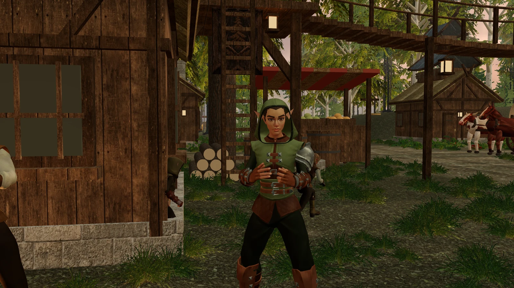
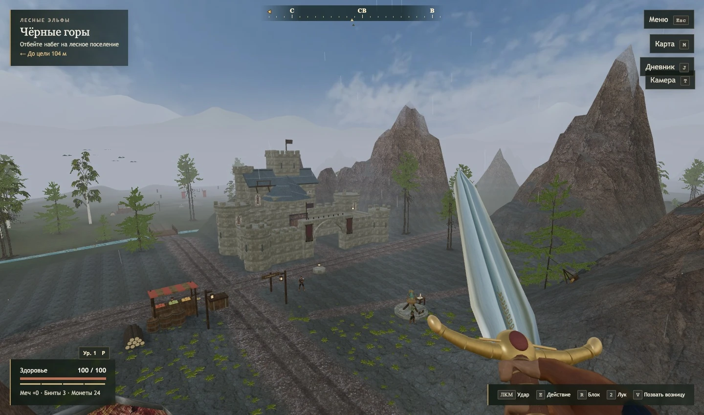
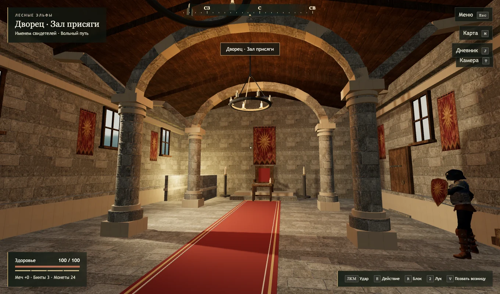
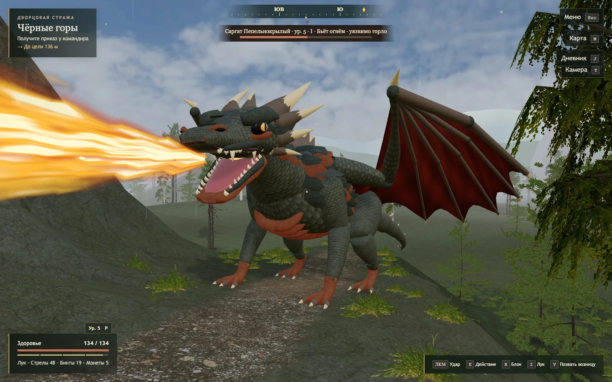
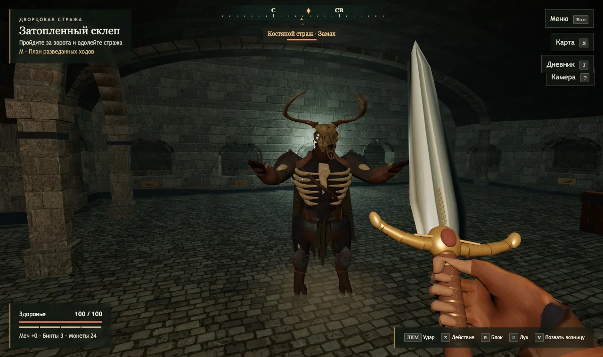

# Соляной тракт — gpt-6.2-astra

В лесу разведчица выводит детей из-под удара. Во дворце капитан задерживает двух лжегонцов. В горах пропажа зерна вынуждает владыку собрать дружину. Выберите, с какой стороны войти в историю исчезнувшего обоза. От любой из трёх родных застав можно уйти в открытый мир.

[Играть на GitHub Pages](https://krestnikov.org/korovany/gpt-6.2-astra-goal/) · [Открыть локальный index.html](./index.html)

Издание **Gpt-6.2-Astra + Goal** создано моделью **`gpt-6.2-astra`**. Это имя указано в метаданных запуска.



## Начать игру

Выберите сторону и нажмите **«Начать игру»**. У каждой стороны своя озвученная сцена на движке. В ней можно сделать паузу, перейти к следующей реплике или сразу вступить в игру. После сцены **J** открывает запись о случившемся и первую цель, **M** открывает карту.

| Сторона и вступление | Первое действие |
| --- | --- |
| Лесные эльфы · «Пока горит окно» | Лиора уводит детей за овраг. Останьтесь у домов и отбейте двух налётчиков. **ЛКМ** или **F** наносит удар, удержание **R** поднимает щит |
| Дворцовая стража · «Без сменного знака» | Двое у ворот назвались гонцами. Подойдите к капитану Арде и нажмите **E**, чтобы получить приказ о защите ворот |
| Тёмный владыка · «Пустой обоз» | Гарнизон остался без зерна. Нажмите **Q** перед строем, выберите цель похода и ведите дружину |

В разделе **«Другие начала»** кнопка **«Сразу в кампанию»** пропускает вступление выбранной стороны. **«Колокол подо льдом»** открывает отдельную историю у причала. Возьмите бирку клавишей **1** или примите швартов клавишей **2**. Выбор меняет первый разговор на берегу.

Кнопка **«Отправиться в экспедицию»** начинает новую игру выбранной стороной у старой переправы и открывает полевой дневник. К истории своей фракции можно вернуться, добравшись до родного поселения.

Для короткого заезда выберите **«Почтовый перегон»** и нажмите **«Взять вожжи»**. На Лесной почте вам передадут шесть хрупких сосудов с лекарством для дворцового лазарета. Тот же рейс доступен у торговца во время кампании.

## Запуск и GitHub Pages

Откройте `index.html` в этой папке. Для запуска по HTTP выполните команду из каталога, в котором лежит папка `gpt-6.2-astra-goal`, и откройте локальную страницу. [Игра на localhost](http://localhost:8000/gpt-6.2-astra-goal/)

```sh
python3 -m http.server 8000
```

Для GitHub Pages скопируйте папку издания целиком в публикуемый каталог. Точка входа — `gpt-6.2-astra-goal/index.html`. Движок, модели, текстуры, музыка и речь загружаются по относительным путям. Установка пакетов требуется только для разработки и тестов.

## Управление

| В кампании | Действие |
| --- | --- |
| WASD и мышь | Идти и смотреть по сторонам. Щелчок по миру захватывает указатель. Стрелки ↑ и ↓ двигают героя, ← и → поворачивают его |
| T | Переключить вид от первого лица и камеру за плечом. В помещении, с луком и при тяжёлой травме используется вид от первого лица |
| Shift, Пробел, C | Бег, прыжок, отскок назад |
| 1, 2 | Взять меч или лук. Повторное нажатие 2 убирает лук |
| ЛКМ или F, G | Обычная атака или выстрел. С мечом G выполняет пробивающий удар |
| ПКМ или R | С мечом — удерживать щит, с луком — приблизить прицел |
| E | Взаимодействовать, говорить, торговать, подбирать груз, пользоваться дверью или лестницей |
| V | Окликнуть возницу. Вдали появляется направление на обоз, вблизи можно подать условный сигнал |
| L | Зажечь или погасить полученный на переправе дорожный фонарь |
| P | Путь героя, опыт до следующего уровня и выбор умений |
| H, Q | Перевязаться или отдать приказ дружине горного владыки |
| J, M, Esc, K | Открыть хронику, посмотреть карту, сделать привал или сохранить игру |

| В почтовом перегоне | Действие |
| --- | --- |
| W / ↑, S / ↓ | Разгон и тормоз. После остановки удерживайте тормоз, чтобы сдать назад |
| A и D / ← и → | Править упряжкой |
| Пробел, V | Позвонить у заставы или сменить камеру между видом с козел и сзади |
| Esc | Пауза. Возврат к последним воротам добавляет четыре секунды |

На сенсорном экране движение задаёт левый джойстик, обзор — смахивание по миру. Справа расположены кнопки действий. В перегоне джойстик одновременно управляет тягой и поворотом. В настройках отдельно регулируются чувствительность мыши, покачивание камеры, качество графики, музыка, эффекты и русская речь.

## Колокол подо льдом

От пристани можно пешком дойти до сигнальной станции, затвора старого водовода, часовни перевозчиков, каменоломни и Верхней звонницы. Низовая дорога огибает озеро. Акведук и северный брод позволяют сменить берег, а верхняя тропа проходит у логова каменных гончих. На **M** открывается карта долины. Нажмите на название места, чтобы оно появилось на компасе. Выйти к четырём землям можно через южное устье. Войти в долину из старого сохранения можно под деревянной аркой за западной переправой.

Вера хранит гарнизонную опись, Савва помнит людей из вычеркнутых дворов. Игрок сам сопоставляет даты на двух документах, направляет воду на колесо и осушает колодец звонницы. Уже найденные свидетельства доступны в дневнике на **J**. Отдельные договорённости со свидетелями открывают три решения. После развязки можно вернуться к людям и увидеть, что стало со станцией, лодкой или переправой. У арки на стороне Соляного тракта тоже останется след принятого решения. Один из исходов даёт дорожный фонарь, который можно взять на ночную вахту или в подземелье.

Полные сутки занимают 16 минут игрового времени. Через **Esc → Подождать до смены света** можно продолжить путь на рассвете, в полдень, вечером или ночью. На тракте вслед за солнцем меняются тени, идут фронты дождя, в окнах зажигается свет. В ясную ночь видно звёзды. [Рассвет у эльфийской деревни](./assets/frontier-dawn.webp) · [Ночная вахта в горах](./assets/frontier-night.webp)

## Три стороны и три пути

- **Лесные эльфы** отбивают налёт на деревянное поселение. У следующего обоза разведчик может договориться с возницей или сразиться с охраной.
- **Дворцовая стража** получает приказ капитана Арды. Нужно защитить южные ворота, выступить против гарнизона старого форта и вернуться с докладом.
- **Тёмный владыка** собирает дружину в Чёрных горах и сам выбирает цель набега. Бойцам можно приказать идти за героем или удерживать позицию.

У мельницы три истории сходятся. У сломанного колеса и кострища остались следы перегрузки. Раненый писарь готов дать показания. Подлинность печати можно проверить по книге помола и в дворцовом архиве. В развилке **«Хлеб без печати»** предстоит провести зерно в голодный лес. **«Именем свидетелей»** ведёт к перехвату регента Вельта, **«Право сильного»** — в казначейство за ключом от амбара. В каждой из трёх ветвей у каждой стороны своё послесловие. После эпилога можно продолжать путь.



## Дома и крепости

Подойдите к двери и нажмите **E**, когда на экране появится название здания. В четырёх домах вольного рынка и четырёх домах эльфийского поселения открываются обе двери. Можно войти с улицы и выйти во двор. Внутри подойдите к верстаку, прилавку или книге, чтобы увидеть доступное действие. Расходы указываются в подсказке до покупки.

| Где искать | Что можно сделать |
| --- | --- |
| Мастерская колёсника и дом ткачихи на вольном рынке | Подгоните обод запасного колеса и получите семь монет. За четыре монеты ткачиха даст полотно для двух бинтов |
| Постоялый двор и лавка рынка | Ночлег стоит три монеты и восстанавливает здоровье и выносливость. В лавке доступны обычные покупки и услуги лекаря |
| Дом лучницы и травная изба в лесу | Оперите шесть стрел за три монеты или приготовьте настой за четыре. Настой останавливает кровотечение и восстанавливает до 42 единиц здоровья |
| Лесная почта и дом дозора | В почтовом реестре можно взять перегон. У дозорных разложена карта Пограничья |

Во дворце пройдите под наружной аркой к большим воротам в глубине двора. Они ведут в **Зал присяги**. У входа справа работает перевязочная. Вдоль правой стены зала есть проход в **Палату печатей**. В архив также ведёт отдельная дверь слева от больших ворот, если смотреть со двора. В Чёрных горах через крепостной двор можно попасть в **Каменный чертог** и пополнить колчан в арсенале. Из обоих залов в подземелья ведёт лестница в конце левого прохода.



[Вид на дворцовые ворота с тракта](./assets/palace-gates.webp) · [Дом ткачихи и её станок](./assets/weavers-house.webp)

В комнате можно нажать **K**. При загрузке герой появляется там, где он был при сохранении, с выполненными поручениями и купленными припасами.

## Тракт, бой и лечение

Вольные земли, Имперский дворец, Эльфийский лес и Чёрные горы соединены дорогами. За горным фортом ищите два вьючных перевала через гряды. Серпантин ведёт на седловину, отвесные склоны преграждают прямой подъём. У реки видны низкие сланцевые пласты, по ним можно пройти. Через реку можно перейти по мосту или вброд. На мелководье ход замедляется. Мир замкнут через края карты. На четырёх заставах смотрители ставят печати в подорожную. У травницы можно получить поручение собрать тысячелистник.

Удар по охраннику, попадание в телегу или попытка грабежа **E** поднимают тревогу. Возница разгоняет упряжку, а два стрелка с задней скамьи натягивают луки. За стеной можно укрыться, стрелу спереди — принять на щит. Догоните задний борт и нажмите **E**, чтобы срезать тюк на ходу. Повреждённая ось или потеря обоих лучников вынуждают возницу остановиться. Для мирного прохода окликните возницу клавишей **V**, запомните последовательность из сигналов **«Свист», «Звон», «Стук»** и ответьте в том же порядке. Старший обоза заверит накладную. Подпись возницы принимают в суде, а знакомый сигнал помогает провести груз через засаду.

[Упряжка входит в поворот](./assets/convoy-turn.webp) · [Лучники защищают груз](./assets/convoy-pursuit.webp)


По обеим сторонам повозки идут разные люди. Новая кампания подбирает им сложение, черты лица, одежду, шлемы, гербы щитов и манеру держать оружие. Один охранник чаще держит фронт и принимает удар на щит. Другой ищет открытый бок и чаще колет. Замах, направление, шаг и решение отступить рассчитываются отдельно для каждого бойца. Сохранение запоминает их облик и состояние боя. [Посмотреть бой с двумя стражниками у обоза — 7,5 секунды игрового процесса](./assets/roles/guard-ambush.mp4)

Попадание отбрасывает героя от источника урона. Стена, повозка или крутой склон могут остановить отступление. На краях экрана выступает красный цвет, возле прицела видны направление удара и потерянное здоровье. При повороте указатель остаётся направлен на место атаки. При **30% здоровья и ниже** края темнеют и слышно сердцебиение. При **15% и ниже** пульс учащается. **H** использует бинт. Покачивание камеры отключается в настройках.

От первого лица при взгляде вниз видны одежда и ноги героя. Взмах меча идёт от плеча через локоть и кисть. Щит в походном положении лежит у левого бедра. Удерживайте блок, чтобы вынести его перед собой. При отпускании герой опускает щит, при попадании — отводит локоть назад. Удар, выстрел и отражённая щитом атака расходуют выносливость. Парирование во время замаха открывает противника для ответного удара. Стрелы летят по дуге и сталкиваются с препятствиями. Павшие остаются лежать в мире. [Запись боя у дворца — взмах, блок и ответный удар](./assets/combat-guard.webp)

| Ранение | Последствие | Помощь |
| --- | --- | --- |
| Рука | Кровотечение, ослабленный удар другой рукой, недоступен лук | Бинт и протез руки |
| Глаз | Закрывается левая половина поля зрения | Глазной протез |
| Нога | Кровотечение, герой ползёт и теряет возможность прыгать | Бинт, коляска или протез ноги |

Бинт останавливает потерю крови и восстанавливает до 34 единиц здоровья. У торговцев доступны лечение, снаряжение, стрелы и три ступени усиления оружия. На мельнице можно отдохнуть у очага.

## Уровни, умения и охота

Герой проходит восемь уровней. Первое очко умений приходит за 65 опыта, пятый уровень открывается при 560, восьмой — при 1710. На каждом новом уровне герой получает шесть здоровья к максимуму, два очка к урону и одно очко умений. Открыть лист героя можно клавишей **P** или кнопкой уровня над здоровьем.

| Ветка | Что меняется в бою |
| --- | --- |
| Клинок | Ответный удар после парирования, пробивание костяной брони, восстановление выносливости за попадание по открытому противнику |
| Лук | Дополнительный урон при стрельбе с прицелом, прерывание атак наземных противников, ускоренный и менее затратный выстрел |
| Выживание | Усиленные перевязки и запас здоровья, дешёвый длинный отскок, снижение урона и риска тяжёлой травмы |

В каждой ветке три умения с порогами 2, 3 и 5. Для продвинутого приёма нужен предыдущий приём той же ветки. Семь доступных очков можно распределить между школами. Победы, улики и дела фракции из прежних сохранений засчитываются при первом продолжении кампании.

[Лист героя и три школы умений](./assets/hero-training.webp)

Охотничьи вести в **J** подскажут, где искать Белогрива (уровень 2) и Колокольную вдову (уровень 4). На низком уровне их древняя защита выдерживает меч, стрелы и парирование. Белогрив предупреждает о броске и после ранения может зайти с фланга повторно. Вдова затягивает петлю там, где заметила героя. После победы подойдите к телу за трофеем.

**Саргат Пепельнокрылый** охраняет Пепельную седловину в Чёрных горах. С пятого уровня герой может пробить его чешую. Во время рёва, взлёта и посадки Саргат закрывает грудь. Когда у него раскаляется горло, уходите в сторону от огненной струи и стреляйте под челюсть. В полёте цельтесь в расправленные перепонки. Следите за кругом на земле и успейте выйти до падения огненного сгустка. Когда Саргат переводит дух, можно сблизиться и нанести тяжёлый удар. Победа приносит 200 опыта. У останков можно забрать янтарную чешую и 145 монет.



[Саргат в полёте](./assets/sargat-flight.webp)

## Полевые исследования

В **J → Экспедиции** можно взять след одного из трёх слухов. Поручение также начинается при встрече с его участниками. Разведанные места появляются на карте. На развилках меняются судьба находки и то, что доступно при возвращении.

- **Три удара над водой.** У старой переправы Рада пытается вернуть колоколам их сигналы. Запись у реки поможет восстановить порядок ударов.
- **Имя под пеплом.** Сопоставьте жетон из печи и имена артели. Судьбу опознанной реликвии предстоит решить в стане угольщиков.
- **Чёрное стекло.** В старой обсерватории разбирают следы дракона. Оплавленная линза и показания прибора укажут направление к безопасному наблюдательному посту.

[Старая переправа](./assets/exploration/river.webp) · [Стан угольщиков](./assets/exploration/names.webp) · [Обсерватория](./assets/exploration/glass.webp)

Вне основных маршрутов спрятаны три тайника. Завершение полевых работ и исследование находок позволяют дойти до уровня дракона мирным путём.

## Подземелья

На мировой карте **M** можно отметить вход во дворец или в старый форт. За воротами войдите в главный зал и найдите лестницу в глубине слева. Клавиша **E** ведёт в **Затопленный склеп** под дворцом или в **Шахты Чёрной жилы** под фортом.

В склепе ищите колесо шлюза, в шахтах — лебёдку. Механизм поднимает решётку на пути к тайнику. Рудная гончая быстро сближается, пещерный ткач делает выпад с края досягаемости меча, а костяной страж заранее отводит руку для тяжёлого удара. Стрелы останавливаются о стены. В ближнем бою можно встретить замах щитом или отскочить.

Под землёй **M** открывает план разведанных ходов. Стрелкой отмечена лестница, шестерёнкой — механизм, ромбом — тайник. В склепе хранится ларец полкового врача с четырьмя бинтами и 36 монетами. В шахте лежат 18 стрел и 56 монет. Ворота, добыча и побеждённые существа сохраняются при возвращении. **K** также запоминает позицию внутри подземелья.



## Почтовый перегон

Пройдите пять ворот по порядку. У двух шлагбаумов подайте звонок с расстояния до 20 метров. На Соляном мосту сбросьте скорость до **18 км/ч**. За мельницей путь уходит направо к лазарету. Удары и слишком быстрый переход через мост могут разбить сосуд. Если пропадут все шесть, рейс закончится.

Рекорд учитывает число доставленных сосудов, затем время. За рейс из кампании лазарет платит по 5 монет за каждый целый сосуд и ещё 10 за полный груз. После расчёта вы вернётесь к своему герою.

## Изображение и звук

На дорогах встречаются объёмные персонажи со скелетной анимацией, а в важных разговорах можно рассмотреть собеседника крупным планом. У ближайших деревьев отдельные объёмные стволы и ветви. Вдали хвойную крону изображают несколько проекций той же модели. Материалы почвы меняются от лесной подстилки до камня у дворца. [Персонажи и художественные материалы](./assets/ART.md) · [Окружение](./assets/environment/CREDITS.md)

В Озёрной марке звучат 29 русских реплик. Лица Веры и Саввы анимированы по записям. Для долины написана отдельная пьеса «Колокола над озером». [Голоса и происхождение записей](./assets/oath/CREDITS.md) · [Партитура](./assets/music/scores/bells-over-the-mere.mid)

В трёх ролевых вступлениях звучат девять реплик шести персонажей. [Сцены, озвучка и текст](./assets/roles/CREDITS.md)

В основной истории **82 русские записи для 14 голосовых ролей**, всего 8 минут 6 секунд. Ещё девять реплик записаны для трёх собеседниц в полевых экспедициях. Для многосложных слов задано явное ударение, а готовые записи проверены акустическим классификатором. Кнопка с динамиком возле имени повторяет реплику. Субтитры в пути можно отключить отдельно. [Озвучка и словарь](./assets/voice/CREDITS.md)

В путешествии звучит **«Соляной тракт»**, в бою — **«Ночная стража»**, у обоза и на почтовом рейсе — **«Переправа на рассвете»**. В мирных помещениях звучит камерная пьеса **«Мельница хранит секреты»**. Музыка становится тише, когда начинается диалог. В лесу слышны ветер и птицы, у воды — ручей, при парировании — столкновение клинков. [Музыка и партитуры MIDI](./assets/music/CREDITS.md) · [Полевые записи и звуки боя](./assets/field/CREDITS.md)

## Сохранения и ограничения

Для каждой стороны доступны ручное сохранение и автоматическая сюжетная контрольная точка. **«Продолжить»** открывает последнюю запись. Рекорд почтового перегона хранится отдельно. Сохранения используют `localStorage` браузера на текущем адресе. Очистка данных сайта удаляет записи. При открытии с диска действуют правила браузера для `file://`.

Игра рассчитана на одного игрока. Четыре области Соляного тракта соединены проходом с Озёрной маркой. В основной кампании восемь жилых домов и мастерских, мельница, архив, два крепостных зала, два подземелья и один почтовый маршрут. Требуется WebGL. Экономное качество графики уменьшает разрешение и сложность теней. Основные игровые сценарии проверяются в настольном Chromium. Вступления, бой и сохранение проверены в Chrome на удалённом Linux. Производительность зависит от разрешения, GPU и настроек теней. Для мобильного управления использовалась эмуляция Chrome.

## Повторение проверок

Из папки издания установите Playwright и выполните нужный сценарий.

```sh
npm install --no-save --package-lock=false playwright
npx playwright install chromium
node tests/campaign.cjs
node tests/regression.cjs
node tests/prologue.cjs
node tests/roles.cjs
node tests/appearance.cjs
node tests/field-ai.cjs
node tests/impact.cjs
node tests/oath.cjs
node tests/march.cjs
node tests/atmosphere.cjs
node tests/post-road.cjs
node tests/presentation.cjs
node tests/equipment.cjs
node tests/underways.cjs
node tests/terrain.cjs
node tests/progression.cjs
node tests/convoy.cjs
node tests/exploration.cjs
node tests/dragon.cjs
node tests/score.cjs
node tests/voices.cjs
```

| Проверка | Что она охватывает |
| --- | --- |
| [Ролевые вступления](./tests/roles.cjs) | Три родных поселения, речь и позы персонажей, первая задача и управление каждым героем |
| [Внешность](./tests/appearance.cjs) | Костюмы и гербы двух охранников, их сохранение и траектории настоящего клинка |
| [Поведение стражи](./tests/field-ai.cjs) | Тревога у обоза, самостоятельные замахи и заходы сбоку, бой оставшегося в живых стражника и восстановление из сохранения |
| [Входящий удар](./tests/impact.cjs) | Реальная атака со спины, отбрасывание, направления двух ударов, блок и уклонение, лечение и столкновение со стеной |
| [Вступление](./tests/prologue.cjs) | Время звучащей реплики, камера и актёры, пауза, естественное завершение и пропуск, обе находки, свободное управление и загрузка |
| [Озёрная марка](./tests/march.cjs) | Двенадцать двусторонних дорог, указатель на карте, бой, прыжок и возвращение на тракт |
| [Часы и погода](./tests/atmosphere.cjs) | Освещение в разное время дня, окна, местные фонари, настройки графики и ожидание |
| [Колокол подо льдом](./tests/oath.cjs) | Проходы между точками, свидетельства, затворы, три решения, встречи после развязки, награды у переправы и фонарь |
| [Кампания](./tests/campaign.cjs) | Три завязки, девять эпилогов, торговля, травмы и восстановление. Ветви проходят от сохранения с ускорением симуляции |
| [Дорога и обоз](./tests/regression.cjs) | Границы мира, столкновения, равномерный шаг обоих сопровождающих обоза, сигналы, ручное сохранение и загрузка |
| [Перегон](./tests/post-road.cjs) | Ворота, скорость на мосту, потеря груза, доставка, рекорд и сенсорное управление |
| [Камера и окружение](./tests/presentation.cjs) | Движение щита при входе в блок и выходе из него, анимация боя за плечом, прицеливание из лука, портрет говорящего капитана, затухание ручья с расстоянием и перенос старой записи журнала |
| [Руки и щит](./tests/equipment.cjs) | Удар по стражнику, непрерывность видимого рукава в 180 кадрах, заслонение у стены, видимое тело и траектория щита |
| [Дороги, перевалы и отвесы](./tests/terrain.cjs) | Высота дороги на всех колеях, связность пешеходных маршрутов, обе стороны перевалов и совпадение склона с коллизией |
| [Опыт и охота](./tests/progression.cjs) | Восемь уровней и три школы, блокировка сильных целей на первом уровне, фазовые атаки двух зверей, трофеи и перенос старых сохранений |
| [Погоня за обозом](./tests/convoy.cjs) | Дуги на четырёх углах, сочленение экипажа, два стрелка, стрела в укрытие и в щит, остановка и добыча |
| [Три экспедиции](./tests/exploration.cjs) | Путь пешком по уликам, шесть развязок, тайники, голоса и сохранение прогресса |
| [Бой с Саргатом](./tests/dragon.cjs) | Защита от новичка, скользящие попадания в закрытую чешую, горло и крыло, три фазы, уклонения, трофей и загрузка |
| [Музыка](./tests/score.cjs) | Пять инструментальных тем, переходы, приглушение под голосом и воспроизведение по HTTP и с диска |
| [Диалоги](./tests/voices.cjs) | Воспроизведение, повтор, остановка, эпилоги и запоминание настроек звука |
| [Произношение](./tools/voice/README.md) | Независимая фонетическая проверка готовых MP3 и разбор результатов |

Сценарий [домов и подземелий](./tests/underways.cjs) проверяет все 20 наружных входов, проход с улицы во двор и выход из каждого здания. Затем он проходит путь от крепостных дверей через оба зала, механизмы, противников и тайники обратно. Посреди каждого похода он сохраняет игру и возобновляет её после перезагрузки страницы.

Для установленного Chrome задайте `BROWSER_EXECUTABLE`. Адрес внешнего статического сервера задаёт `GAME_URL`. Звуковой сценарий создаёт временный сервер, а затем запускает ту же игру с диска. Для проверки звука в Playwright WebKit установите `npx playwright install webkit`. Музыкальный сценарий принимает `SCORE_BROWSER=webkit`, голосовой — `VOICE_BROWSER=webkit`. Голосовой сценарий по умолчанию открывает файл с диска. Для проверки реплик по HTTP передайте ему `GAME_URL`.
