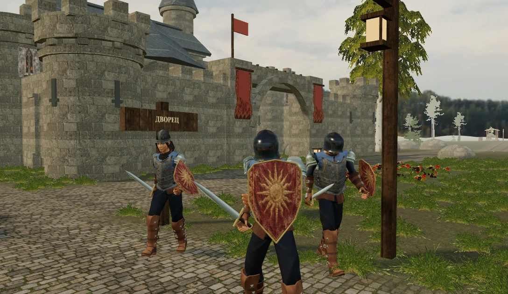

# Соляной тракт — gpt-6.2-astra

Семь телег с зерном вышли из леса. До мельницы дошли шесть. В этом одиночном 3D-приключении можно пройти по следу пропавшего обоза от лица эльфийского разведчика, дворцового стражника или владыки горного форта. Найденные улики пригодятся каждой стороне. Кому достанется зерно, решает игрок.

[Играть на GitHub Pages](http://krestnikov.org/korovany/gpt-6.2-astra-goal/) · [Открыть локальный index.html](./index.html)

Издание **Gpt-6.2-Astra + Goal** создано моделью **`gpt-6.2-astra`**. Это имя указано в метаданных запуска.


## Начать игру

Выберите сторону и нажмите **«Начать историю»**. Отметка на компасе ведёт к первой цели. Эльф начинает с обороны поселения — ударьте мечом кнопкой мыши или **F**. Стражнику нужно подойти к Арде и нажать **E**, а владыке — открыть приказы клавишей **Q**. Карта открывается на **M**, хроника с уликами и текущим заданием — на **J**.

Для короткого заезда выберите **«Почтовый перегон»** и нажмите **«Взять вожжи»**. На Лесной почте вам передадут шесть хрупких сосудов с лекарством для дворцового лазарета. Тот же рейс доступен у торговца во время кампании.

## Запуск и GitHub Pages

Откройте `index.html` в этой папке. Для запуска по HTTP выполните команду из каталога, в котором лежит папка `gpt-6.2-astra-goal`, и откройте локальную страницу. [Игра на localhost](http://localhost:8000/gpt-6.2-astra-goal/)

```sh
python3 -m http.server 8000
```

Для GitHub Pages скопируйте папку издания целиком в публикуемый каталог. Точка входа — `gpt-6.2-astra-goal/index.html`. Движок, модели, текстуры, музыка и речь загружаются по относительным путям. Установка пакетов требуется только для разработки и тестов.

## Управление

| В кампании | Действие |
| --- | --- |
| WASD и мышь | Идти и смотреть по сторонам. Щелчок по миру захватывает указатель. Стрелки ↑ и ↓ двигают героя, ← и → поворачивают его |
| T | Переключить вид от первого лица и камеру за плечом. В помещении, с луком и при тяжёлой травме используется вид от первого лица |
| Shift, Пробел, C | Бег, прыжок, отскок назад |
| 1, 2 | Взять меч или лук. Повторное нажатие 2 убирает лук |
| ЛКМ или F, G | Обычная атака или выстрел. С мечом G выполняет пробивающий удар |
| ПКМ или R | С мечом — удерживать щит, с луком — приблизить прицел |
| E | Взаимодействовать, говорить, торговать, подбирать груз, пользоваться дверью или лестницей |
| V | Окликнуть возницу. Вдали появляется направление на обоз, вблизи можно подать условный сигнал |
| H, Q | Перевязаться или отдать приказ дружине горного владыки |
| J, M, Esc, K | Открыть хронику, посмотреть карту, сделать привал или сохранить игру |

| В почтовом перегоне | Действие |
| --- | --- |
| W / ↑, S / ↓ | Разгон и тормоз. После остановки удерживайте тормоз, чтобы сдать назад |
| A и D / ← и → | Править упряжкой |
| Пробел, V | Позвонить у заставы или сменить камеру между видом с козел и сзади |
| Esc | Пауза. Возврат к последним воротам добавляет четыре секунды |

На сенсорном экране движение задаёт левый джойстик, обзор — смахивание по миру. Справа расположены кнопки действий. В перегоне джойстик одновременно управляет тягой и поворотом. В настройках отдельно регулируются чувствительность мыши, покачивание камеры, качество графики, музыка, эффекты и русская речь.

## Три стороны и три пути

- **Лесные эльфы** отбивают налёт на деревянное поселение. У следующего обоза разведчик может договориться с возницей или сразиться с охраной.
- **Дворцовая стража** получает приказ капитана Арды. Нужно защитить южные ворота, выступить против гарнизона старого форта и вернуться с докладом.
- **Тёмный владыка** собирает дружину в Чёрных горах и сам выбирает цель набега. Бойцам можно приказать идти за героем или удерживать позицию.

У мельницы три истории сходятся. У сломанного колеса и кострища остались следы перегрузки. Раненый писарь готов дать показания. Подлинность печати можно проверить по книге помола и в дворцовом архиве. В развилке **«Хлеб без печати»** предстоит провести зерно в голодный лес. **«Именем свидетелей»** ведёт к перехвату регента Вельта, **«Право сильного»** — в казначейство за ключом от амбара. В каждой из трёх ветвей у каждой стороны своё послесловие. После эпилога можно продолжать путь.



## Тракт, бой и лечение

Вольные земли, Имперский дворец, Эльфийский лес и Чёрные горы соединены дорогами. Через реку можно перейти по мосту или вброд. На мелководье ход замедляется. Мир замкнут через края карты. На четырёх заставах смотрители ставят печати в подорожную. У травницы можно получить поручение собрать тысячелистник.

**E** у телеги позволяет ограбить обоз после боя с охраной. Для мирного прохода окликните возницу клавишей **V**, запомните последовательность из сигналов **«Свист», «Звон», «Стук»** и ответьте в том же порядке. Старший обоза заверит накладную. Подпись возницы принимают в суде, а знакомый сигнал помогает провести груз через засаду.

Удар, выстрел и отражённая щитом атака расходуют выносливость. Парирование во время замаха открывает противника для ответного удара. Стрелы летят по дуге и сталкиваются с препятствиями. Павшие остаются лежать в мире.

| Ранение | Последствие | Помощь |
| --- | --- | --- |
| Рука | Кровотечение, ослабленный удар другой рукой, недоступен лук | Бинт и протез руки |
| Глаз | Закрывается левая половина поля зрения | Глазной протез |
| Нога | Кровотечение, герой ползёт и теряет возможность прыгать | Бинт, коляска или протез ноги |

Бинт останавливает потерю крови и восстанавливает до 34 единиц здоровья. У торговцев доступны лечение, снаряжение, стрелы и три ступени усиления оружия. На мельнице можно отдохнуть у очага.

## Почтовый перегон

Пройдите пять ворот по порядку. У двух шлагбаумов подайте звонок с расстояния до 20 метров. На Соляном мосту сбросьте скорость до **18 км/ч**. За мельницей путь уходит направо к лазарету. Удары и слишком быстрый переход через мост могут разбить сосуд. Если пропадут все шесть, рейс закончится.

Рекорд учитывает число доставленных сосудов, затем время. За рейс из кампании лазарет платит по 5 монет за каждый целый сосуд и ещё 10 за полный груз. После расчёта вы вернётесь к своему герою.

## Изображение и звук

На дорогах встречаются объёмные персонажи со скелетной анимацией, а в важных разговорах можно рассмотреть собеседника крупным планом. У ближайших деревьев отдельные объёмные стволы и ветви. Вдали хвойную крону изображают несколько проекций той же модели. Материалы почвы меняются от лесной подстилки до камня у дворца. [Персонажи и художественные материалы](./assets/ART.md) · [Окружение](./assets/environment/CREDITS.md)

В игре **82 русские записи и 14 голосов**, всего 8 минут 6 секунд. Для многосложных слов задано явное ударение, а готовые записи проверены акустическим классификатором. Кнопка с динамиком возле имени повторяет реплику. Субтитры в пути можно отключить отдельно. [Озвучка и словарь](./assets/voice/CREDITS.md)

В путешествии звучит **«Соляной тракт»**, в бою — **«Ночная стража»**, у обоза и на почтовом рейсе — **«Переправа на рассвете»**. Для мельницы и архива написана камерная пьеса **«Мельница хранит секреты»**. Музыка становится тише, когда начинается диалог. В лесу слышны ветер и птицы, у воды — ручей, при парировании — столкновение клинков. [Музыка и партитуры MIDI](./assets/music/CREDITS.md) · [Полевые записи и звуки боя](./assets/field/CREDITS.md)

## Сохранения и ограничения

Для каждой стороны доступны ручное сохранение и автоматическая сюжетная контрольная точка. **«Продолжить»** открывает последнюю запись. Рекорд почтового перегона хранится отдельно. Сохранения используют `localStorage` браузера на текущем адресе. Очистка данных сайта удаляет записи. При открытии с диска действуют правила браузера для `file://`.

Игра рассчитана на одного игрока. В ней четыре области, два доступных интерьера и один почтовый маршрут. Требуется WebGL. Экономное качество графики уменьшает разрешение и сложность теней. Основные игровые сценарии проверяются в настольном Chromium. На контрольной точке у деревни в Chrome на macOS при 1280 × 800 и сбалансированном качестве медиана и 90-й процентиль времени кадра за 110 кадров составили 16,7 мс. Для мобильного управления использовалась эмуляция Chrome.

## Повторение проверок

Из папки издания установите Playwright и выполните нужный сценарий.

```sh
npm install --no-save --package-lock=false playwright
npx playwright install chromium
node tests/campaign.cjs
node tests/regression.cjs
node tests/post-road.cjs
node tests/presentation.cjs
node tests/score.cjs
node tests/voices.cjs
```

| Проверка | Что она охватывает |
| --- | --- |
| [Кампания](./tests/campaign.cjs) | Три завязки, девять эпилогов, торговля, травмы и восстановление. Ветви проходят от сохранения с ускорением симуляции |
| [Дорога и обоз](./tests/regression.cjs) | Границы мира, столкновения, поведение упряжки, сигналы, ручное сохранение и загрузка |
| [Перегон](./tests/post-road.cjs) | Ворота, скорость на мосту, потеря груза, доставка, рекорд и сенсорное управление |
| [Камера и окружение](./tests/presentation.cjs) | Анимация боя за плечом, прицеливание из лука, портрет говорящего капитана, затухание ручья с расстоянием и перенос старой записи журнала |
| [Музыка](./tests/score.cjs) | Четыре темы, переходы, приглушение под голосом и воспроизведение по HTTP и с диска |
| [Диалоги](./tests/voices.cjs) | Воспроизведение, повтор, остановка, эпилоги и запоминание настроек звука |
| [Произношение](./tools/voice/README.md) | Независимая фонетическая проверка готовых MP3 и разбор результатов |

Для установленного Chrome задайте `BROWSER_EXECUTABLE`. Адрес внешнего статического сервера задаёт `GAME_URL`. Звуковой сценарий создаёт временный сервер, а затем запускает ту же игру с диска. Для проверки звука в Playwright WebKit установите `npx playwright install webkit`. Музыкальный сценарий принимает `SCORE_BROWSER=webkit`, голосовой — `VOICE_BROWSER=webkit`. Голосовой сценарий по умолчанию открывает файл с диска. Для проверки реплик по HTTP передайте ему `GAME_URL`.
